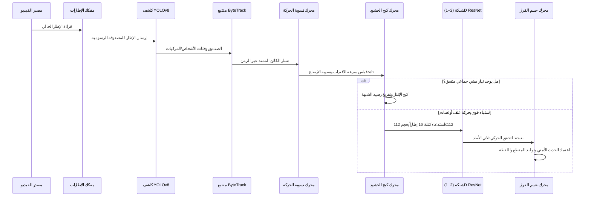

# دليل محرك الذكاء الاصطناعي والاستدلال — AI Worker Subsystem
## RASD AI (رَصْد AI) AI Inference Pipeline & Vision Intelligence Manual

---

## 1. الغرض من المجلد (Purpose)
يمثل مجلد `ai_worker/` القلب الحسابي والذكي لمنصة رَصْد (RASD AI). يحتوي هذا المجلد على خط أنابيب الرؤية الحاسوبية المعقد (Computer Vision Pipeline)، ونماذج التعلم العميق (Deep Learning)، وخوارزميات التتبع متعدد الكائنات (Multi-Object Tracking)، ومحركات الحسابات الفيزيائية والحركية التي تحول إطارات الفيديو الخام إلى أحداث أمنية ذكية ومفسرة.

---

## 2. الوظيفة التي يؤديها داخل المشروع
- **تفكيك إطارات الفيديو (Frame Decoding)**: قراءة إطارات البث المباشر أو الملفات المخزنة بدقة زمنية عالية واستقرار في الذاكرة.
- **كشف الكائنات ثنائي الأبعاد (Spatial Detection)**: استخراج الصناديق المحيطة (Bounding Boxes) للأشخاص والمركبات باستخدام شبكة YOLOv8.
- **التتبع الزمني متعدد الأهداف (MOT Tracking)**: تتبع مسار كل كائن عبر الزمن ومنحه معرّفاً ثابتاً (`track_id`) باستخدام خوارزمية ByteTrack.
- **تسوية المقاييس الحركية (Scale-Normalized Motion)**: حساب السرعة المنسوبة لارتفاع الكائن ($v/h$) والتسارع ($a/h$) للتخلص من أثر تشوه المنظور الهندسي للكاميرا (Perspective Distortion).
- **كبح الإنذارات الكاذبة (False Alarm Suppression)**: تحليل التيارات الجماعية وحركة الحشود لمنع اعتبار المشي الطبيعي عراكاً أو شجاراً.
- **التحقق المكاني-الزمني العصبوني ثلاثي الأبعاد**: استدعاء شبكة (2+1)D ResNet العصبية للتحقق من الحركة العنيفة عبر 16 إطاراً قبل إطلاق التنبيه النهائي.
- **حسم القرار وتوثيق الأدلة**: إصدار القرار الأمني الموحد، استخراج اللقطة التوثيقية، واقتطاع المقطع الجنائي ذي الـ 15 ثانية.

---

## 3. الهيكل الداخلي وأهم المجلدات والملفات

```
ai_worker/
├── requirements.txt            # متطلبات بايثون (PyTorch, Torchvision, Ultralytics, OpenCV...)
├── Dockerfile                  # تهيئة تشغيل العامل في بيئة معزولة تدعم بطاقات NVIDIA GPU
└── src/
    ├── main.py                 # مشغل العامل ومستمع قائمة المهام
    ├── buffer.py               # تخزين مسارات الكائنات وتاريخ حركتها في إطارات دائرية
    ├── state_machine.py        # آلة الحالات المنطقية لحركة الكائنات
    ├── core/                   # 45 وحدة منطقية متقدمة:
    │   ├── normalized_motion_engine.py    # حساب السرعة والتباطؤ بالنسبة للارتفاع (v/h و a/h)
    │   ├── false_positive_firewall.py     # جدار الحماية ضد الإنذارات الكاذبة
    │   ├── suppression_evidence_engine.py # كبح الأدلة عند رصد تيار حشود منسجم
    │   ├── temporal_3d_verifier.py        # وسيط فحص الكتل الفيديوية عبر شبكة 3D ResNet
    │   ├── evidence_engine.py             # تجميع الأدلة واضمحلالها التلقائي مع الوقت
    │   ├── device_manager.py              # إدارة التحويل التلقائي بين GPU و CPU
    │   └── pipeline.py                    # خط الأنابيب الرئيسي المجمع لكافة المراحل
    ├── detectors/
    │   ├── yolo_detector.py    # مغلف استدعاء كاشف YOLOv8
    │   └── pose_detector.py    # كاشف النقاط المفصلية الهيكلية (17 مفصلاً)
    ├── tracker/
    │   └── byte_tracker.py     # تطبيق خوارزمية التتبع ByteTrack لربط الكائنات عبر الزمن
    ├── domains/                # عزل النطاقات الأمنية (Domain Isolation Architecture):
    │   ├── violence/           # منطق كشف العنف والاعتداء الجسدي المستقل
    │   └── collision/          # منطق كشف اصطدام المركبات والمشاة المستقل
    ├── models_3d/
    │   └── spatiotemporal_3d_net.py # المعمارية العصبية لشبكة التحقق الحركي ثلاثية الأبعاد
    ├── engines/                # محركات الدعم والقرار:
    │   ├── decision_fusion_engine.py # المحرك الوحيد المخول بإصدار القرار النهائي
    │   ├── risk_scoring_engine.py    # حساب مؤشر الخطورة المركب (من 0 إلى 100)
    │   ├── video_clip_engine.py      # اقتطاع المقطع الجنائي (5s قبل الحادث و 10s بعده)
    │   └── snapshot_engine.py        # حفظ لقطة الإطار الثابت عند ذروة الحادث
    └── plugins/                # إضافات الكشف الأمني (Violence, Collision, Theft, Stubs)
```

---

## 4. مراحل خط الأنابيب البرمجي بالتفصيل (The Processing Pipeline)



---

## 5. نماذج الذكاء الاصطناعي وطريقة تشغيلها

### أ. كاشف YOLOv8 (`models/yolov8n.pt`)
- **الدور**: كشف الأشخاص (Class 0) والسيارات (Class 2) والشاحنات والحافلات في كل إطار منفرد.
- **طريقة العمل**: استدلال بتمريرة واحدة (Single-Shot) على مصفوفة صور بحجم `640x480` بكسل.

### ب. متتبع المسارات ByteTrack (`ai_worker/src/tracker/byte_tracker.py`)
- **الدور**: حل مشكلة انقطاع الكشف المؤقت عبر مرحلتي مطابقة (Two-Stage Data Association) بالاعتماد على مصفوفة التداخل المكاني (IoU) ومرشح كالمان (Kalman Filter).

### ج. شبكة (2+1)D ResNet (`ai_worker/src/models_3d/spatiotemporal_3d_net.py`)
- **الدور**: التحقق من أن النمط الحركي عبر 16 إطاراً متتابعاً يمثل تصرفاً عدائياً أو اصطداماً فيزيائياً حقيقياً، مما يخفض الإنذارات الكاذبة بنسبة تتجاوز 90%.

---

## 6. خطوات الاختبار والتحقق الحقيقي

1. **اختبار كبح إنذارات الحشود (Mall Walking Real Video Benchmark)**:
   ```bash
   python -m unittest tests/real_video/test_mall_walking.py -v
   ```
   - يمرر فيديو حقيقي لمتسوقين في مركز تجاري ويثبت أن النظام لا يطلق أي إنذار عنف خاطئ.
2. **اختبار استدلال النموذج ثلاثي الأبعاد (3D ResNet Test)**:
   ```bash
   python -m unittest tests/test_spatiotemporal_3d.py -v
   ```
   - يختبر تغذية موتر بحجم `[1, 3, 16, 112, 112]` والتأكد من توافقه مع الذاكرة الرسومية VRAM.

---

## 7. أسئلة المناقشة الأكاديمية الخاصة بالـ AI Worker

### س1: لماذا لا نستخدم نموذج YOLO مباشرة لكشف العنف؟
**الإجابة النموذجية**:
- لأن YOLO هو كاشف كائنات مكاني ثنائي الأبعاد (Spatial 2D Object Detector)، يدرب على صور فردية ثابتة لتحديد موقع الصناديق المحيطة للأشخاص والمركبات، ولا يمتلك بعداً زمنياً (Temporal Dimension) لفهم ما إذا كان الشخص يقف أو يركض أو يضرب. لذلك، نستخدم YOLO للكشف، ونبني فوقه تتبع ByteTrack، ثم نقيس الديناميكا الحركية، ونستدعي شبكة 3D ResNet ثلاثية الأبعاد لفحص تسلسل الإطارات عبر الزمن.

### س2: ما هي معادلة تسوية السرعة ($v/h$) ولماذا تعتبر جوهرية للنظام؟
**الإجابة النموذجية**:
- إذا تحرك شخص قريب من الكاميرا مسافة 50 بكسل في ثانية، بينما تحرك شخص بعيد في عمق المشهد مسافة 10 بكسل، فإن الشخص البعيد قد يكون أسرع بكثير على أرض الواقع، لكنه يبدو صغيراً بسبب المنظور (Perspective Distortion). معادلة $v/h$ تقسم الإزاحة بالبكسل على ارتفاع الشخص في الصورة بالبكسل، مما يعطي سرعة نسبية مستقلة تماماً عن مسافة الشخص من الكاميرا وتضمن دقة متماثلة في كافة أرجاء المشهد.

---

## 8. روابط الشروحات التفصيلية لملفات الـ AI Worker
- [شرح pipeline.py التفصيلي](file:///e:/final%20project/AI%20Security%20Platform%20V2/docs/file-reference/ai_worker_pipeline.py.md)
- [شرح yolo_detector.py التفصيلي](file:///e:/final%20project/AI%20Security%20Platform%20V2/docs/file-reference/ai_worker_yolo_detector.py.md)
- [شرح byte_tracker.py التفصيلي](file:///e:/final%20project/AI%20Security%20Platform%20V2/docs/file-reference/ai_worker_byte_tracker.py.md)
- [شرح spatiotemporal_3d_net.py التفصيلي](file:///e:/final%20project/AI%20Security%20Platform%20V2/docs/file-reference/ai_worker_spatiotemporal_3d_net.py.md)
- [شرح violence_detector.py التفصيلي](file:///e:/final%20project/AI%20Security%20Platform%20V2/docs/file-reference/ai_worker_violence_detector.py.md)
- [شرح collision_detector.py التفصيلي](file:///e:/final%20project/AI%20Security%20Platform%20V2/docs/file-reference/ai_worker_collision_detector.py.md)
